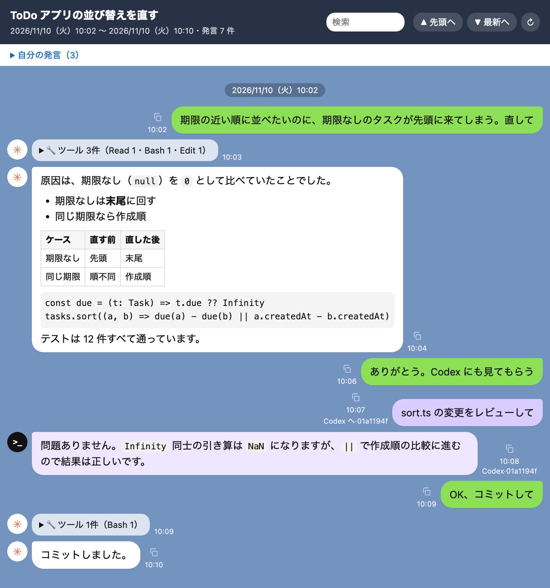

# lime
lineじゃなくてlimeです。
Claude Code の会話を、チャットの吹き出し風の HTML にして読み返すための mod です。`/lime` と打つと今の会話を HTML にして開き、会話が進むと自動で更新します。

cmux の中ではブラウザのタブ（横のペイン）で、それ以外では既定のブラウザで開きます。



## できること

- 自分の発言は右、Claude の発言は左に吹き出しで並べる（Markdown を整形）
- ツールの実行と長い発言は折りたたむ
- 目次・会話内の検索・発言ごとのコピー
- 発言に書かれたローカルの画像・HTML・PDF の縮小画像を出す
- 同じ作業フォルダで使った Codex の会話も、時刻順に混ぜて出す

## 必要なもの

- Claude Code 2.1.287 以降
- macOS（縮小画像に `sips` と `qlmanage` を使います）
- cmux（任意）。あれば横のブラウザのペインに開いて自動更新します。無ければ既定のブラウザで開きます（自動更新なし）

## 導入

```bash
claude plugin marketplace add nakamura-shuta/claude-mod-lime
claude plugin install lime@nakamura-mods
```

## 使い方

```text
/lime                 今の会話を開く
/lime <セッションID>  ほかの会話を開く
/lime-codex on|off    同じ作業フォルダの Codex のやりとりを、発言のたびに Claude に渡す（既定は off）
```

始めたばかりの会話は、最初の発言までは記録が無いので開けません。

## 何を読み書き・実行するか

| 種類 | 内容 |
|---|---|
| 読む | 会話記録 `~/.claude/projects/`、Codex の会話記録 `~/.codex/sessions/`、発言に書かれたローカルのファイル |
| 書く | `~/.claude/lime/`（HTML と縮小画像） |
| 実行する | `awk`・`sed`・`head`・`tail`・`mkdir`・`chmod`・`mv`・`rm`・`sips`・`qlmanage`・`cmux`・`open` |
| 外への通信 | この mod 自身はしない。`/lime-codex on` のときだけ、Codex のやりとり（発言と実行したコマンド、8,000 字まで）が Claude へ送る context に添えられる |

## 制限

- 30MB を超える会話記録は、新しい側の 30MB だけを読みます
- HTML は 4 MiB に収めるため、大きな会話ではツールの結果や古い発言を省きます
- 古い縮小画像は自動では消えません（`~/.claude/lime/<セッションID>-assets/`）

## 開発

```bash
claude plugin test lime       # テスト
claude plugin validate lime   # mod として読み込めるかの検査
```

コードは `lime/hooks/` にあります。Claude Code の機能（`$`）を使う処理は `register.ts` に、会話記録の解釈や HTML の組み立ては `$` を使わない関数として別のファイルに置いています。
